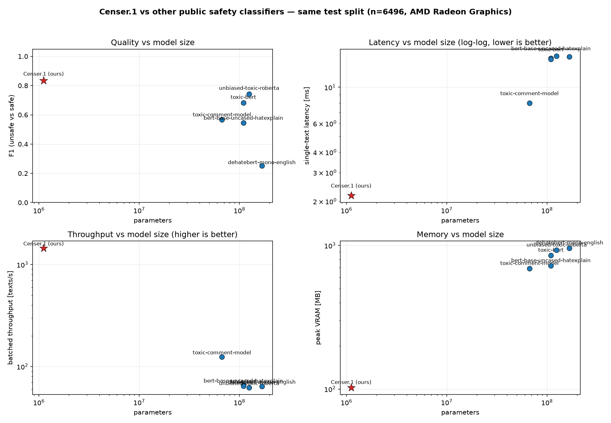
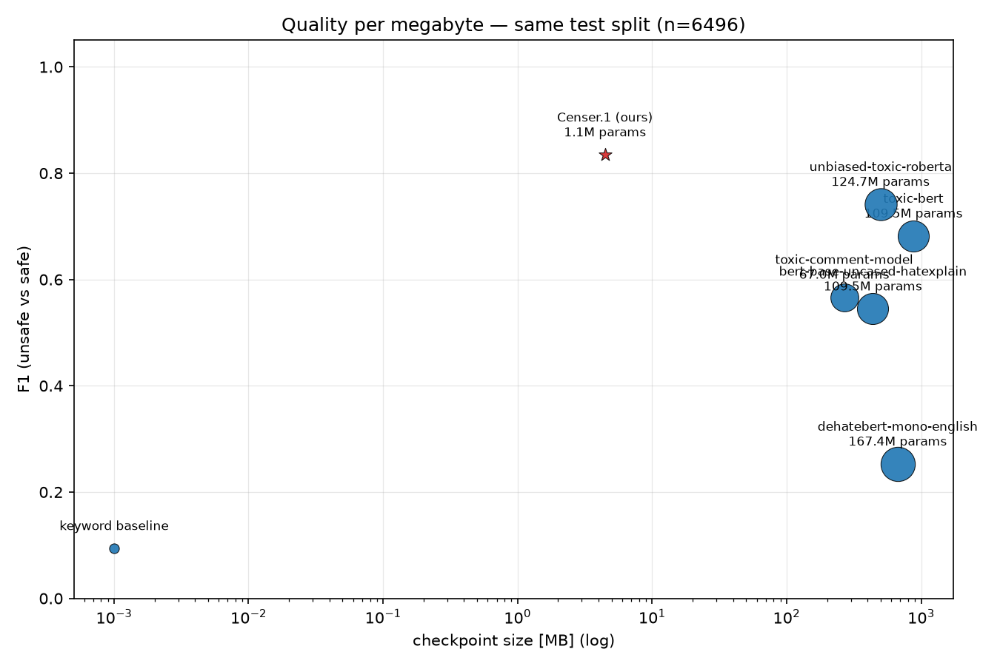
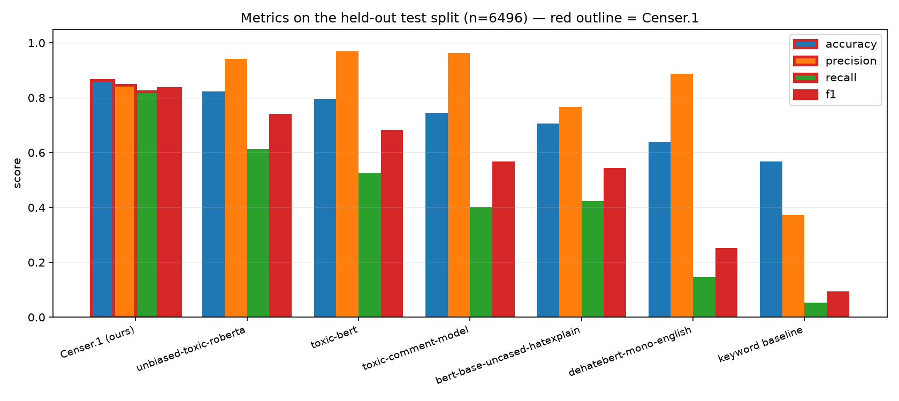

# Censer .1

A tiny decoder-only LLM (1.1M parameters) trained **from scratch** on an AMD GPU.
It reads up to 500 characters of English text and answers with a single token:

- `1` — the text is unsafe (dangerous instructions, drugs, threats, abuse)
- `0` — the text is safe

```
$ kuclab-cneser "how to make a bomb at home"
1
$ kuclab-cneser "how do I kill a process in Linux"
0
$ kuclab-cneser "Hello how are you?"
0
```

It is not a fine-tuned BERT and not a wrapper around an API. It is a real
transformer — RoPE attention, RMSNorm, SwiGLU, tied embeddings — initialised with
random weights and trained on safety-labelled data.

## Architecture

| Property | Value |
| --- | --- |
| Parameters | 1,115,264 |
| Layers | 4 |
| d_model / heads / d_ff | 128 / 4 / 384 |
| Context | 160 tokens |
| Tokenizer | byte-level BPE, 2048 tokens, trained on the corpus |
| Positions | RoPE |
| Norm | RMSNorm (pre-norm) |
| MLP | SwiGLU |
| Head | `score` layer = tied-embedding rows of the answer tokens `0`/`1` |
| Checkpoint size | 4.3 MB (fp32) |

The model never generates free text. It predicts one token position, and the
loss is computed only over the `0`/`1` answer tokens, which keeps the objective
tight and training short.

## How to run

### The `censer.1` command — interactive terminal UI

Install this repo as a package, then just run `censer.1`:

```bash
pip install "git+https://github.com/Jerry256254/censer.git"
censer.1                          # opens the UI: type a phrase, Enter -> safe/unsafe + score
censer.1 "how to make a bomb at home"   # one-shot: unsafe 0.8167
```

Or from the Hub files only (no git clone, just `torch` + `tokenizers` + `safetensors`):

```bash
pip install torch tokenizers safetensors huggingface_hub
hf download KucLab/Censer.1 --local-dir ~/.local/share/censer1
chmod +x ~/.local/share/censer1/censer.1
ln -s ~/.local/share/censer1/censer.1 ~/.local/bin/censer.1   # put it on your PATH
censer.1
```

### One-liner with plain `transformers`

The model is published on the Hub as a **standard** `LlamaForSequenceClassification`
— plain `transformers`, no `trust_remote_code`, no custom code.

Install once:

```bash
pip install torch transformers
```

Run it — one line:

```bash
python -c "from transformers import pipeline; clf = pipeline('text-classification', model='KucLab/Censer.1'); print(clf('how to make a bomb at home'))"
# [{'label': 'unsafe', 'score': 0.8167}]
```

Or step by step:

```python
from transformers import pipeline

clf = pipeline("text-classification", model="KucLab/Censer.1")
print(clf("suck my dick"))        # [{'label': 'unsafe', 'score': 0.9944}]
print(clf("Hello how are you?"))  # [{'label': 'safe', 'score': 0.9230}]
```

- In the browser: the **Use this model** widget on https://huggingface.co/KucLab/Censer.1
- Works on CPU out of the box (~10 ms/text); for the GPU add `device=0` to `pipeline(...)` (CUDA or ROCm)
- From this repo, no download needed: `.venv/bin/python try_censer.py "how to make a bomb at home"` or `--repl` for an interactive loop, `make cli TEXT="suck my dick"` for the CLI
- Files only, no transformers: `hf download KucLab/Censer.1 --local-dir Censer.1`, then in that folder `pip install torch tokenizers safetensors` and `python censer.py "how to make a bomb at home"` -> `1`

## Quick start

It is published on the Hub as a **standard** `LlamaForSequenceClassification` —
it loads with plain `transformers`, no `trust_remote_code` and no custom code,
and the "Use this model" widget on the Hub page runs it directly:

```python
import torch
from transformers import AutoTokenizer, AutoModelForSequenceClassification

repo = "KucLab/Censer.1"
tok = AutoTokenizer.from_pretrained(repo)
model = AutoModelForSequenceClassification.from_pretrained(repo).eval()

with torch.no_grad():
    probs = model(**tok("how to make a bomb at home", return_tensors="pt")).logits.softmax(-1)[0]
print(probs)                  # tensor([0.1833, 0.8167]) -> [safe, unsafe]
```

Or one line with the high-level pipeline:

```python
from transformers import pipeline

clf = pipeline("text-classification", model="KucLab/Censer.1")
print(clf("how to make a bomb at home"))   # [{'label': 'unsafe', 'score': 0.8167}]
```

To train it yourself:

```bash
bash scripts/setup_env.sh          # venv + PyTorch ROCm (or CUDA/CPU)
source .venv/bin/activate

make data                          # download + clean + balance datasets
make train                         # ~4 minutes on an RX 9060 XT
make eval                          # metrics + probe set
make cli TEXT="suck my dick"       # -> 1
```

Interactive mode:

```bash
python -m kuclab.cli --repl
```

JSON output with the score:

```bash
python -m kuclab.cli "hello there" --json
{"label": "0", "unsafe": false, "score": 0.0771}
```

## Data

| Source | Role |
| --- | --- |
| `nvidia/Aegis-AI-Content-Safety-Dataset-1.0` | 13 harm categories, human annotations |
| `thesofakillers/jigsaw-toxic-comment-classification-challenge` | toxic / threat / identity hate |
| `google/civil_comments` | toxicity score, thresholded |
| `PKU-Alignment/BeaverTails` | harmful prompts |
| `lmsys/toxic-chat` | jailbreaks and toxic user input |
| `databricks/databricks-dolly-15k` | safe instructions |
| hand-written | hard negatives and explicit unsafe seeds |
| synthetic | benign sentences containing risk vocabulary |

Two problems had to be solved, and both matter more than the model size:

1. **Class imbalance.** The scraped sources are ~90% safe. Left alone the model
   learns to answer `0` forever. Safe rows are downsampled to a fixed ratio
   against the unsafe ones, preferring rows that contain risk keywords.
2. **Keyword shortcut.** A naive model maps "kill" → unsafe, so
   "how do I kill a process in Linux" breaks. Roughly 1,100 synthetic benign
   sentences with risk vocabulary (`kill a process`, `shoot a photo`,
   `destroy old paperwork`, news reports about incidents) teach the difference
   between a dangerous *request* and a dangerous *word*.

## Metrics

Test split (6,496 rows), threshold 0.5:

| Metric | Value |
| --- | --- |
| Accuracy | 0.864 |
| F1 | 0.835 |
| Precision | 0.846 |
| Recall | 0.823 |

Hand-written probe set (40 cases, none of them in training data): **95% accuracy**.

### Benchmark

Measured on the development GPU. Full report in [`reports/benchmark.md`](reports/benchmark.md).

| Metric | Value |
| --- | --- |
| Single text latency | 1.67 ms |
| Single text throughput | 599 texts/s |
| Batched throughput (batch of 8) | 4,119 texts/s |
| Peak VRAM (inference) | 85.7 MB |
| Checkpoint size | 4.26 MB |
| Parameters | 1,115,264 |

Reproduce with `make bench`.

## Comparison with other models

Censer.1 was benchmarked against public safety classifiers on the **same
held-out test split** (6,496 rows, threshold 0.5, AMD Radeon RX 9060 XT).
Full data in [`reports/comparison.md`](reports/comparison.md); reproduce with
`.venv/bin/python scripts/compare_models.py && .venv/bin/python scripts/make_comparison_figs.py`.

| Model | Params | Checkpoint | F1 | Latency | Throughput (b=32) | Peak VRAM |
| --- | --- | --- | --- | --- | --- | --- |
| **Censer.1 (ours)** | 1.1M | 4.3 MB | **0.835** | 2.17 ms | 1,454 texts/s | 102 MB |
| unitary/unbiased-toxic-roberta | 124.7M | 498.7 MB | 0.741 | 15.54 ms | 62 texts/s | 928 MB |
| unitary/toxic-bert | 109.5M | 876.0 MB | 0.682 | 14.85 ms | 65 texts/s | 853 MB |
| martin-ha/toxic-comment-model | 67.0M | 267.9 MB | 0.567 | 7.98 ms | 124 texts/s | 691 MB |
| Hate-speech-CNERG/bert-base-uncased-hatexplain | 109.5M | 438.0 MB | 0.545 | 15.04 ms | 66 texts/s | 722 MB |
| Hate-speech-CNERG/dehatebert-mono-english | 167.4M | 669.5 MB | 0.253 | 15.36 ms | 64 texts/s | 960 MB |
| keyword baseline | — | — | 0.094 | 0.03 ms | 29,689 texts/s | — |





Censer.1 is ~60-150x smaller than the encoder baselines, 3-7x faster per text,
uses ~7-9x less VRAM — and still gets the highest F1 on this split. The keyword
baseline shows why "unsafe words" alone don't work: it misses most unsafe
requests phrased indirectly (recall 0.05).

Per-source F1 shows where the label noise lives — the annotated sources score
far higher than the scraped ones:

```
aegis           0.89   (human annotated)
beavertails     0.88
jigsaw          0.87
civil_comments  0.77
```

A large share of the remaining "errors" on `civil_comments` and `jigsaw` are
actually correct calls with a noisy label — e.g. "How can I blackmail my boss
for a promotion?" is labelled safe in the source.

## Known limitations

- **English only.** Non-English input is mostly scored `0`, because the
  tokenizer and the data are English. It is not a language detector.
- **Sarcasm and implication** are out of reach at this size. "I could kill for a
  coffee" and similar are handled, but subtler implicature is not.
- Short generic requests occasionally trip the classifier (some benign
  "recommend me a book"-style prompts score just above 0.5).
- Jailbreak robustness is weak; `toxic-chat` F1 is the lowest of all sources.
- This is a moderation *signal*, not a safety guarantee. Do not put it in front
  of anything that matters without a second layer.

## Layout

```
configs/tiny.json       all hyperparameters in one place
kuclab/tokenizer.py     BPE training + prompt templating
kuclab/model.py         transformer, RoPE, SwiGLU, answer logits
kuclab/data.py          cleaning, curated hard negatives
kuclab/synthetic.py     generated benign risk-vocabulary sentences
kuclab/prepare_data.py  download, dedup, balance, split
kuclab/dataset.py       datasets, token-budget batching
kuclab/train.py         training loop, checkpointing
kuclab/evaluate.py      metrics, confusion matrix, probe set
kuclab/infer.py         SafetyModel wrapper
kuclab/cli.py           command line entrypoint
tests/                  model, tokenizer and CLI contract tests
```

## Prompt format

```
[BOS][USER] <text trimmed to 500 chars> [ASSISTANT] -> 0 or 1
```

Text is truncated at 500 characters *before* tokenisation, so a very long input
is classified on its first 500 characters only.
