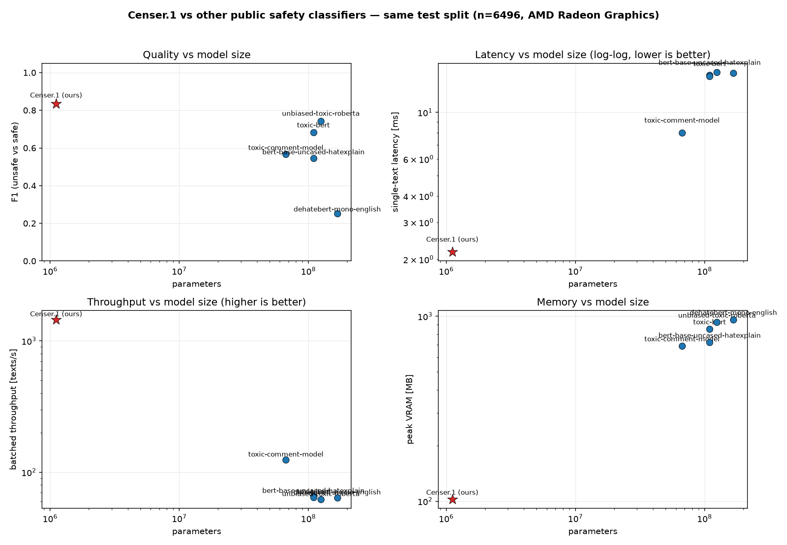
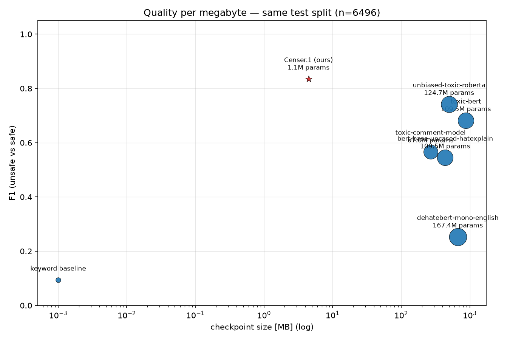
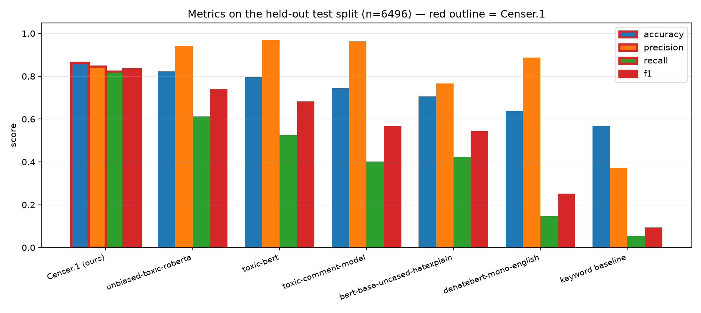

# Comparison with other public safety classifiers

Same held-out test split for every model: `data/processed/test.jsonl` (n=6496), threshold 0.5. Hardware: AMD Radeon Graphics.

| Model | Params | Checkpoint | Accuracy | Precision | Recall | F1 | Latency | Throughput (b=32) | Peak VRAM |
| --- | --- | --- | --- | --- | --- | --- | --- | --- | --- |
| Censer.1 (ours) | 1.1M | 4.5 MB | 0.864 | 0.846 | 0.823 | **0.835** | 2.17 ms | 1454 texts/s | 102 MB |
| unbiased-toxic-roberta | 124.7M | 498.7 MB | 0.822 | 0.941 | 0.612 | **0.741** | 15.54 ms | 62 texts/s | 928 MB |
| toxic-bert | 109.5M | 876.0 MB | 0.796 | 0.970 | 0.526 | **0.682** | 14.85 ms | 65 texts/s | 853 MB |
| toxic-comment-model | 67.0M | 267.9 MB | 0.744 | 0.963 | 0.402 | **0.567** | 7.98 ms | 124 texts/s | 691 MB |
| bert-base-uncased-hatexplain | 109.5M | 438.0 MB | 0.706 | 0.766 | 0.423 | **0.545** | 15.04 ms | 66 texts/s | 722 MB |
| dehatebert-mono-english | 167.4M | 669.5 MB | 0.637 | 0.887 | 0.147 | **0.253** | 15.36 ms | 64 texts/s | 960 MB |
| keyword baseline | 0.0M | 0.0 MB | 0.568 | 0.374 | 0.054 | **0.094** | 0.03 ms | 29689 texts/s | 0 MB |

Reproduce: `.venv/bin/python scripts/compare_models.py && .venv/bin/python scripts/make_comparison_figs.py`
